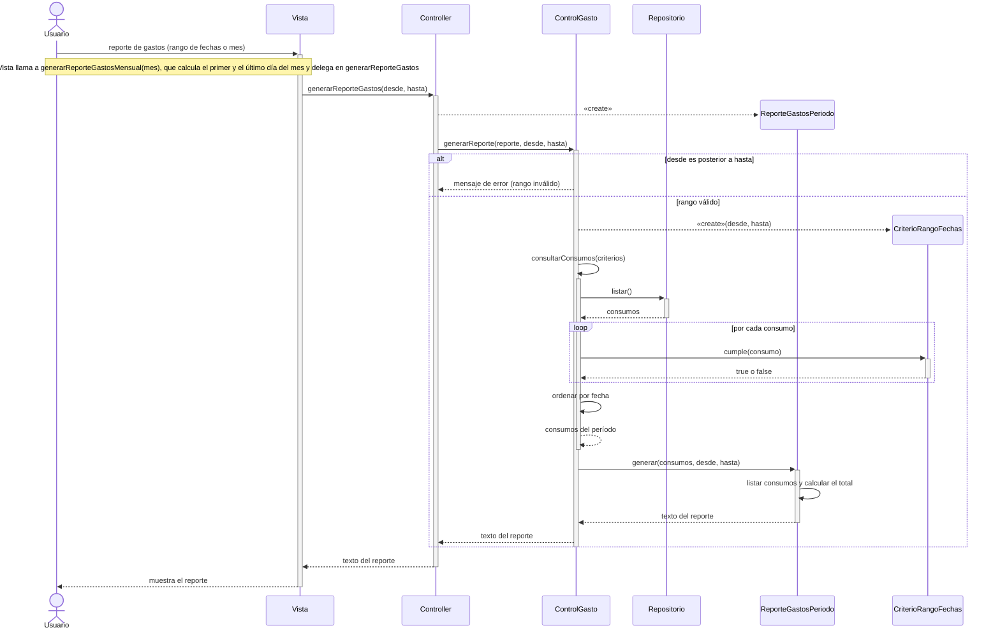

# CU10 – Consultar gastos del período

> La consulta de consumos con filtros pasó al **CU4 – Consultar y filtrar consumos** (ver [CU4.md](CU4.md)). Este caso de uso genera los reportes de gastos del período.

## Reporte de gastos (por rango de fechas o por mes)

