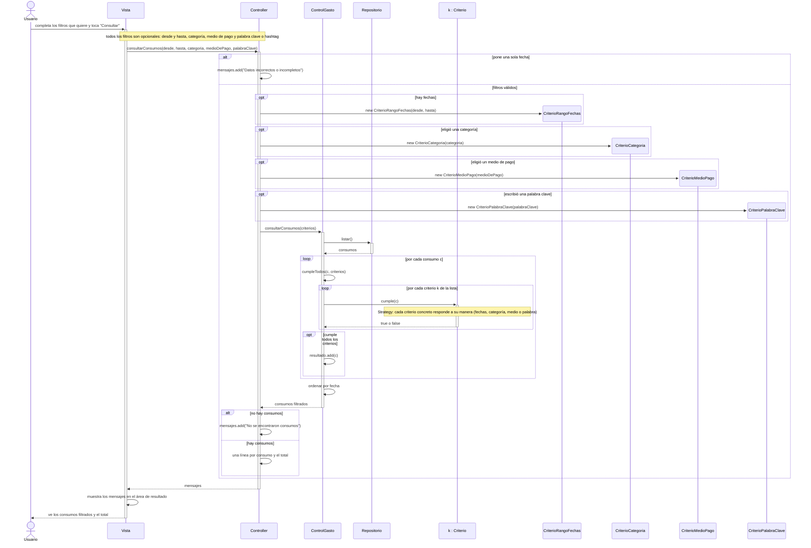

# CU4 – Consultar y filtrar consumos

Todos los filtros son opcionales. El `Controller` crea un `Criterio` por cada filtro elegido y `ControlGasto` los aplica sin saber cuáles son (patrón Strategy).

