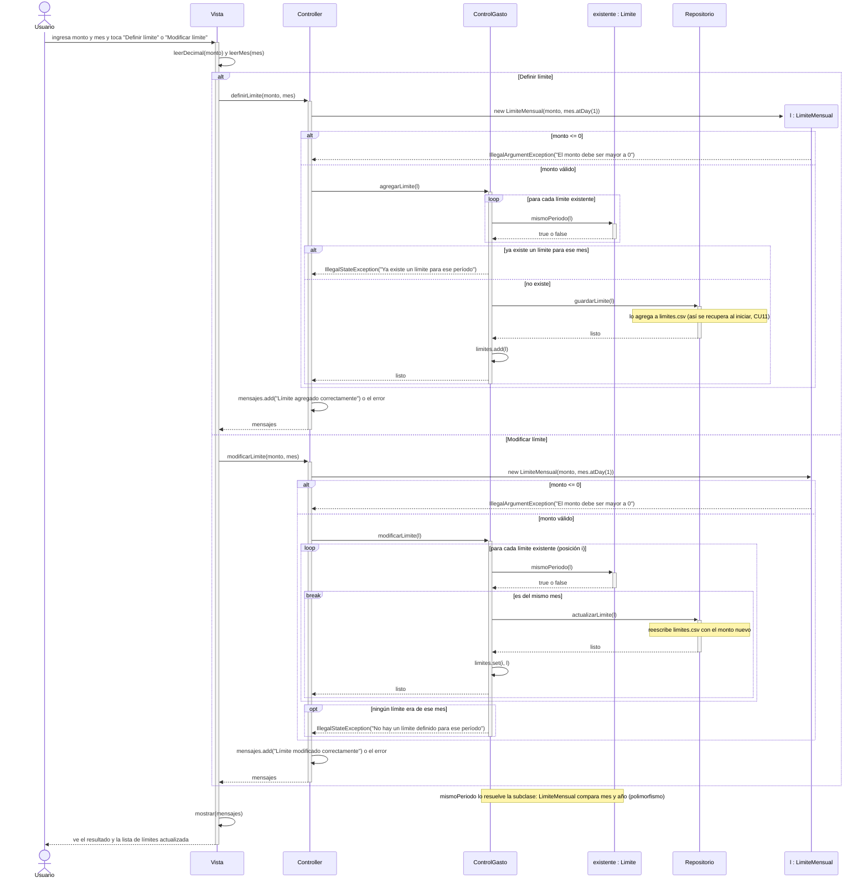

# CU5 – Definir y modificar límite

Hay un solo límite por mes. El diagrama tiene las dos operaciones del caso de uso: definir un límite nuevo y modificar el de un mes que ya tiene límite. En los dos casos el límite queda guardado en `limites.csv` para recuperarlo al iniciar (CU11). `Limite` es abstracta: `ControlGasto` trabaja con ella y cada subclase (hoy `LimiteMensual`) resuelve `mismoPeriodo` a su manera.

