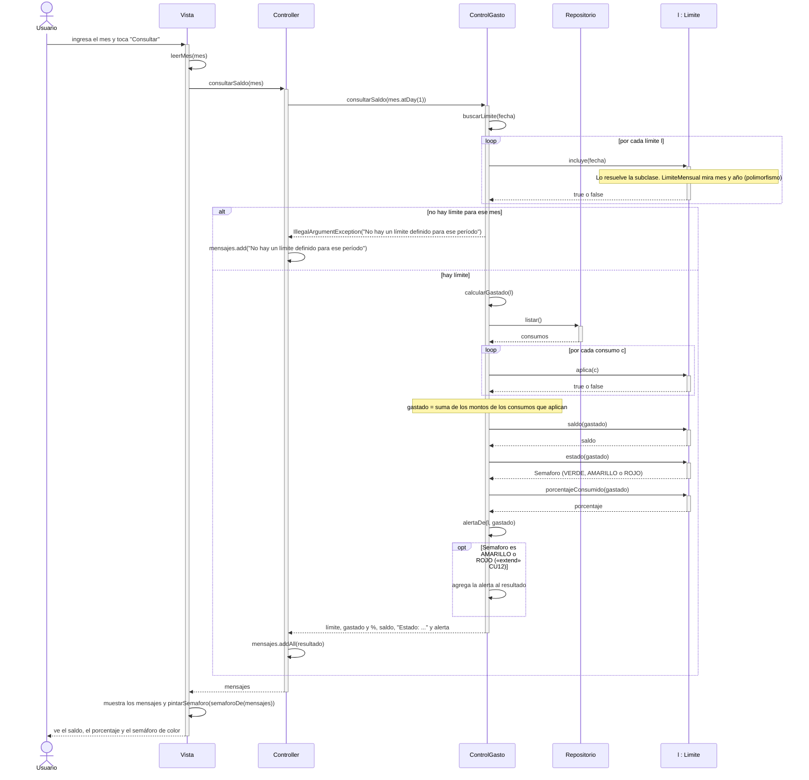

# CU6 – Consultar saldo y estado

Muestra el límite del mes, lo gastado, el porcentaje consumido, el saldo disponible y el estado con un semáforo de colores (VERDE: menos del 80 %, AMARILLO: desde el 80 %, ROJO: desde el 95 %). Si está en AMARILLO o ROJO agrega la alerta del CU12 («extend»).

