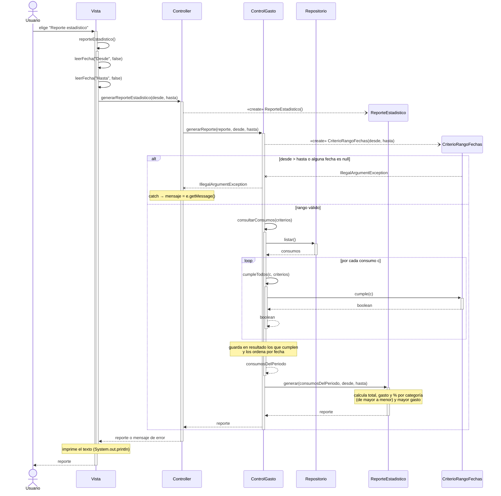

# CU9 – Consultar reporte estadístico

## Dónde está cada paso en el código

| Paso del diagrama | Clase y línea | Código |
|---|---|---|
| `reporteEstadistico()` | `Vista` l.41 → l.137 | `case 5: reporteEstadistico();` |
| `leerFecha("Desde"/"Hasta", false)` | `Vista` l.138–139 | `LocalDate desde = leerFecha("Desde (dd/MM/yyyy): ", false);` |
| `generarReporteEstadistico(desde, hasta)` | `Vista` l.141 → `Controller` l.145 | `public String generarReporteEstadistico(LocalDate desde, LocalDate hasta)` |
| nota: imprime el texto | `Vista` l.141 | `System.out.println(controller.generarReporteEstadistico(desde, hasta));` |
| `«create» ReporteEstadistico()` | `Controller` l.147 | `new ReporteEstadistico()` |
| `generarReporte(reporte, desde, hasta)` | `Controller` l.147 → `ControlGasto` l.192 | `controlGasto.generarReporte(new ReporteEstadistico(), desde, hasta)` |
| `«create» CriterioRangoFechas(desde, hasta)` | `ControlGasto` l.194 | `criterios.add(new CriterioRangoFechas(desde, hasta))` |
| `IllegalArgumentException` | `CriterioRangoFechas` l.11 y l.13 | `throw new IllegalArgumentException(...)` |
| catch → `e.getMessage()` | `Controller` l.148–149 | `catch (IllegalArgumentException e) { return e.getMessage(); }` |
| `consultarConsumos(criterios)` | `ControlGasto` l.195 → l.173 | `reporte.generar(consultarConsumos(criterios), desde, hasta)` |
| `listar()` | `ControlGasto` l.175 | `for (Consumo c : repositorio.listar())` |
| `cumpleTodos(c, criterios)` | `ControlGasto` l.176 → l.182 | `if (cumpleTodos(c, criterios)) resultado.add(c);` |
| `cumple(c)` | `CriterioRangoFechas` l.20–21 | `return !c.getFecha().isBefore(desde) && !c.getFecha().isAfter(hasta);` |
| nota: ordena por fecha | `ControlGasto` l.178 | `resultado.sort(Comparator.comparing(Consumo::getFecha));` |
| retorno `consumosDelPeriodo` | `ControlGasto` l.179 | `return resultado;` |
| `generar(consumosDelPeriodo, desde, hasta)` | `ControlGasto` l.195 | `reporte.generar(...)` (polimorfismo: `reporte` es de tipo `Reporte`) |
| nota: total y gasto por categoría | `ReporteEstadistico` l.25–29 | `total += c.getMonto();` y `porCategoria.merge(...)` |
| nota: de mayor a menor y % | `ReporteEstadistico` l.35–40 | `entradas.sort(...)` y `e.getValue() * 100 / total` |
| nota: mayor gasto | `ReporteEstadistico` l.42 | `entradas.get(0).getKey()` |
| retorno `reporte` | `ReporteEstadistico` l.43 | `return sb.toString();` |

## Notación UML 2.5.1 usada

- **Mensaje síncrono** (línea llena, punta rellena): una llamada a una operación que existe en el diagrama de clases.
- **Mensaje de creación** (línea punteada, punta abierta, apunta a la cabecera de la línea de vida, con `«create»`): corresponde a un `new` en el código. El objeto aparece recién a esa altura.
- **Mensaje de respuesta** (línea punteada): el `return` del método, con el valor devuelto.
- **Automensaje**: llamada a un método de la misma clase (`leerFecha`, `consultarConsumos`, `cumpleTodos`), con su barra de activación anidada.
- **Fragmentos combinados** `alt` y `loop` con su guarda (Mermaid la dibuja entre corchetes).
- **Notas**: el cálculo interno de un método que no llama a otra operación del modelo se muestra como nota (comentario UML) y no como mensaje.

## GRASP en este caso de uso

- **Controlador:** `Controller` recibe el evento de sistema desde la `Vista` y lo delega a `ControlGasto`; la `Vista` nunca toca el dominio ni el repositorio.
- **Creador:** `Controller` crea `ReporteEstadistico` porque es quien sabe qué reporte se pidió; `ControlGasto` crea `CriterioRangoFechas` porque tiene los datos para inicializarlo (`desde`, `hasta`) y es quien lo usa.
- **Experto en información:** `CriterioRangoFechas.cumple()` decide si un consumo está en el rango porque conoce las fechas; `ReporteEstadistico.generar()` calcula las estadísticas; `ControlGasto.consultarConsumos()` filtra porque tiene acceso a los consumos.
- **Polimorfismo:** `ControlGasto` llama a `reporte.generar(...)` sobre la interfaz `Reporte` y a `cumple(c)` sobre la interfaz `Criterio`; el mismo `generarReporte` sirve para el CU10 con `ReporteGastosPeriodo`.
- **Bajo acoplamiento / Variaciones protegidas:** `ControlGasto` depende solo de las interfaces `Repositorio`, `Reporte` y `Criterio`, no de las clases concretas.
- **Alta cohesión:** cada clase hace una sola cosa: `Vista` lee y muestra, `Controller` coordina y traduce errores a mensajes, `ControlGasto` filtra, `ReporteEstadistico` arma el reporte.
- **Indirección:** `Repositorio` separa la lógica de negocio del acceso a los archivos CSV.
