# Diagrama de clases – Gestor de Gastos

Diagrama generado a partir del código de la carpeta `Codigo/`. Cada atributo, método, visibilidad y relación corresponde a lo que está implementado.

> Nombres en el código: `ReporteInterfaz` → `Reporte`, `RepositorioInterfaz` → `Repositorio`, `MedioDePago` → `MedioPago`. Se incluye también la interfaz `Criterio`, que es la que implementan `CriterioRangoFechas` y `CriterioCategoria`.

```mermaid
classDiagram
    direction TB

    %% ===================== PRESENTACIÓN =====================
    

    class Vista {
        -DateTimeFormatter FECHA$
        -DateTimeFormatter MES$
        -Controller controller
        -Scanner in
        +Vista(Controller controller)
        +iniciar() void
        -definirLimite() void
        -registrarConsumo() void
        -menuCategorias() void
        -menuMediosPago() void
        -reporteEstadistico() void
        -menuGastosPeriodo() void
        -consultarConsumos() void
        -mostrar(List~String~ mensajes) void
        -buscarCategoria(int id) Categoria
        -buscarMedio(int id) MedioPago
        -leerEntero(String texto) int
        -leerDecimal(String texto) double
        -leerFecha(String texto, boolean opcional) LocalDate
        -leerMes(String texto) YearMonth
    }

    %% ===================== CONTROL =====================
    class Controller {
        -ControlGasto controlGasto
        +Controller(Repositorio repositorio)
        +agregarLimite(Limite l) void
        +ingresarDatosConsumo(double monto, LocalDate fecha, String descripcion, int cuotas, Categoria categoria, MedioPago medioDePago) List~String~
        -validarDatos(double monto, LocalDate fecha, int cuotas, Categoria categoria, MedioPago medioDePago) boolean
        +agregarCategoria(String nombre) List~String~
        +modificarCategoria(int id, String nuevoNombre) List~String~
        +eliminarCategoria(int id) List~String~
        +obtenerCategorias() List~Categoria~
        +agregarMedioPago(String nombre) List~String~
        +modificarMedioPago(int id, String nuevoNombre) List~String~
        +eliminarMedioPago(int id) List~String~
        +obtenerMediosPago() List~MedioPago~
        +generarReporteEstadistico(LocalDate desde, LocalDate hasta) String
        +consultarConsumos(LocalDate desde, LocalDate hasta, Categoria categoria) List~String~
        +generarReporteGastos(LocalDate desde, LocalDate hasta) String
        +generarReporteGastosMensual(YearMonth mes) String
    }

    class ControlGasto {
        -Repositorio repositorio
        -List~Limite~ limites
        +ControlGasto(Repositorio repositorio)
        +agregarLimite(Limite l) void
        +registrar(Consumo c) List~String~
        -calcularGastado(Limite l) double
        +agregarCategoria(String nombre) boolean
        +getCategorias() List~Categoria~
        +modificarCategoria(int id, String nuevoNombre) void
        +eliminarCategoria(int id) void
        -buscarCategoria(int id) Categoria
        -existeNombreCategoria(String nombre, int idExcluido) boolean
        +agregarMedioPago(String nombre) boolean
        +getMediosPago() List~MedioPago~
        +modificarMedioPago(int id, String nuevoNombre) void
        +eliminarMedioPago(int id) void
        -buscarMedio(int id) MedioPago
        -existeNombre(String nombre, int idExcluido) boolean
        +consultarConsumos(List~Criterio~ criterios) List~Consumo~
        -cumpleTodos(Consumo c, List~Criterio~ criterios) boolean
        +generarReporte(Reporte reporte, LocalDate desde, LocalDate hasta) String
    }

    %% ===================== DOMINIO =====================
    class Consumo {
        -int id
        -double monto
        -LocalDate fecha
        -String descripcion
        -int cuotas
        -Categoria categoria
        -MedioPago medioDePago
        +Consumo(double monto, LocalDate fecha, String descripcion, int cuotas, Categoria categoria, MedioPago medioDePago)
        +Consumo(int id, double monto, LocalDate fecha, String descripcion, int cuotas, Categoria categoria, MedioPago medioDePago)
        +getId() int
        +setId(int id) void
        +getMonto() double
        +getFecha() LocalDate
        +getDescripcion() String
        +getCuotas() int
        +getCategoria() Categoria
        +getMedioDePago() MedioPago
    }

    class Categoria {
        -int id
        -String nombre
        +Categoria(int id, String nombre)
        +Categoria(String nombre)
        +getId() int
        +setId(int id) void
        +getNombre() String
        +setNombre(String nombre) void
        +equals(Object o) boolean
        +hashCode() int
        +toString() String
    }

    class MedioPago {
        -int id
        -String nombre
        +MedioPago(int id, String nombre)
        +getId() int
        +setId(int id) void
        +getNombre() String
        +setNombre(String nombre) void
        +equals(Object o) boolean
        +hashCode() int
        +toString() String
    }

    class Limite {
        <<abstract>>
        #double monto
        #LocalDate fechaReferencia
        -double rojo$
        -double amarillo$
        +Limite(double monto, LocalDate fechaReferencia)
        +getMonto() double
        +saldo(double gastado) double
        +estado(double gastado) Semaforo
        +aplica(Consumo c)* boolean
        +mismoPeriodo(Limite otro)* boolean
    }

    class LimiteMensual {
        +LimiteMensual(double monto, LocalDate fechaReferencia)
        +aplica(Consumo c) boolean
        +mismoPeriodo(Limite otro) boolean
    }

    class Semaforo {
        <<enumeration>>
        ROJO
        AMARILLO
        VERDE
    }

    %% ===================== FILTROS (Strategy) =====================
    class Criterio {
        <<interface>>
        +cumple(Consumo c) boolean
    }

    class CriterioRangoFechas {
        -LocalDate desde
        -LocalDate hasta
        +CriterioRangoFechas(LocalDate desde, LocalDate hasta)
        +cumple(Consumo c) boolean
    }

    class CriterioCategoria {
        -Categoria categoria
        +CriterioCategoria(Categoria categoria)
        +cumple(Consumo c) boolean
    }

    %% ===================== REPORTES (Strategy) =====================
    class Reporte {
        <<interface>>
        +generar(List~Consumo~ consumos, LocalDate desde, LocalDate hasta) String
    }

    class ReporteEstadistico {
        -DateTimeFormatter FORMATO$
        +generar(List~Consumo~ consumos, LocalDate desde, LocalDate hasta) String
    }

    class ReporteGastosPeriodo {
        -DateTimeFormatter FORMATO$
        -Categoria categoria
        +ReporteGastosPeriodo()
        +ReporteGastosPeriodo(Categoria categoria)
        +generar(List~Consumo~ consumos, LocalDate desde, LocalDate hasta) String
    }

    %% ===================== PERSISTENCIA =====================
    class Repositorio {
        <<interface>>
        +guardar(Consumo c) void
        +listar() List~Consumo~
        +guardarCategoria(Categoria c) void
        +listarCategorias() List~Categoria~
        +actualizarCategoria(Categoria c) void
        +eliminarCategoria(int id) void
        +guardarMedioPago(MedioPago m) void
        +listarMediosPago() List~MedioPago~
        +actualizarMedioPago(MedioPago m) void
        +eliminarMedioPago(int id) void
    }

    class RepositorioArchivo {
        -String SEP$
        -Path archivo
        -Path archivoMedios
        -Path archivoCategorias
        +RepositorioArchivo(String rutaConsumos, String rutaMedios, String rutaCategorias)
        +RepositorioArchivo()
        +guardar(Consumo c) void
        +listar() List~Consumo~
        +guardarCategoria(Categoria c) void
        +listarCategorias() List~Categoria~
        +actualizarCategoria(Categoria c) void
        +eliminarCategoria(int id) void
        +guardarMedioPago(MedioPago m) void
        +listarMediosPago() List~MedioPago~
        +actualizarMedioPago(MedioPago m) void
        +eliminarMedioPago(int id) void
        -siguienteId() int
        -aLinea(Consumo c) String
        -deLinea(String linea, Map~Integer,MedioPago~ medios, Map~Integer,Categoria~ categorias) Consumo
        -siguienteIdCategoria() int
        -categoriasPorId() Map~Integer,Categoria~
        -categoriaALinea(Categoria c) String
        -reescribirCategorias(List~Categoria~ categorias) void
        -siguienteIdMedio() int
        -mediosPorId() Map~Integer,MedioPago~
        -medioALinea(MedioPago m) String
        -reescribirMedios(List~MedioPago~ medios) void
        -leerLineas(Path ruta) List~String~
        -agregarLinea(Path ruta, String linea, String que) void
        -escribirLineas(Path ruta, List~String~ lineas) void
        -limpiar(String s) String
    }

    %% ===================== RELACIONES ESTRUCTURALES =====================
    Vista "1" --> "1" Controller : controller
    Controller "1" *-- "1" ControlGasto : controlGasto
    ControlGasto "1" --> "1" Repositorio : repositorio
    ControlGasto "1" o-- "0..*" Limite : limites

    Consumo "0..*" --> "1" Categoria : categoria
    Consumo "0..*" --> "1" MedioPago : medioDePago
    CriterioCategoria "0..*" --> "1" Categoria : categoria
    ReporteGastosPeriodo "0..*" --> "0..1" Categoria : categoria

    %% ===================== HERENCIA / REALIZACIÓN =====================
    Limite <|-- LimiteMensual
    Criterio <|.. CriterioRangoFechas
    Criterio <|.. CriterioCategoria
    Reporte <|.. ReporteEstadistico
    Reporte <|.. ReporteGastosPeriodo
    Repositorio <|.. RepositorioArchivo

    %% ===================== DEPENDENCIAS =====================
    
    Vista ..> LimiteMensual : «create»

    Controller ..> Consumo : «create»
    Controller ..> CriterioRangoFechas : «create»
    Controller ..> CriterioCategoria : «create»
    Controller ..> ReporteEstadistico : «create»
    Controller ..> ReporteGastosPeriodo : «create»

    ControlGasto ..> Criterio : usa
    ControlGasto ..> Reporte : usa
    ControlGasto ..> Semaforo : usa
    ControlGasto ..> Categoria : «create»
    ControlGasto ..> MedioPago : «create»

    Limite ..> Semaforo : devuelve
    Limite ..> Consumo : evalúa
    Criterio ..> Consumo : evalúa
    Reporte ..> Consumo : procesa
    Repositorio ..> Consumo : persiste
    RepositorioArchivo ..> Consumo : «create»
```

## Lectura de las relaciones

| Relación | Tipo | Por qué (en el código) |
|---|---|---|
| Vista → Controller | Asociación | `Vista` guarda `private final Controller controller`. |
| Controller ◆— ControlGasto | Composición | `Controller` crea su `ControlGasto` en el constructor y nadie más lo conoce: vive y muere con él. |
| ControlGasto → Repositorio | Asociación | Atributo `repositorio`, recibido por constructor (inyección de dependencia). |
| ControlGasto ◇— Limite | Agregación 0..* | `List<Limite> limites`; los límites se crean afuera (en `Vista`) y se agregan con `agregarLimite`. |
| Consumo → Categoria / MedioPago | Asociación *..1 | Cada consumo tiene exactamente una categoría y un medio de pago. |
| CriterioCategoria → Categoria | Asociación | Atributo `final Categoria categoria`. |
| ReporteGastosPeriodo → Categoria | Asociación 0..1 | Atributo opcional (`null` = sin categoría en el título). |
| Limite ◁— LimiteMensual | Herencia | `LimiteMensual extends Limite`. |
| Criterio, Reporte, Repositorio ◁┈ implementaciones | Realización | `implements`. |
| Líneas punteadas | Dependencia | Uso como parámetro, retorno o variable local (`«create»` = la clase hace `new`). |

## GRASP aplicado

| Patrón | Dónde se cumple |
|---|---|
| **Controlador** | `Controller` es el controlador de fachada: recibe todos los eventos de sistema que dispara `Vista` (registrar consumo, ABM de categorías/medios, reportes) y los delega a `ControlGasto`. La `Vista` nunca toca el dominio ni el repositorio. |
| **Experto en información** | `Limite` calcula `saldo()` y `estado()` porque tiene `monto` y los umbrales; `LimiteMensual` decide `aplica()` y `mismoPeriodo()` porque conoce su `fechaReferencia`; cada `Criterio` decide `cumple()` con sus propios datos; cada `Reporte` arma su propio texto; `ControlGasto` calcula lo gastado porque tiene los límites y acceso al repositorio. |
| **Creador** | `Controller` crea `Consumo` porque tiene los datos de inicialización (los recibe de la vista); `RepositorioArchivo` crea `Consumo`, `Categoria` y `MedioPago` al leer el CSV (tiene los datos); `Controller` crea su `ControlGasto` (lo contiene). |
| **Bajo acoplamiento** | `ControlGasto` depende de las interfaces `Repositorio`, `Reporte` y `Criterio`, no de las clases concretas. `Vista` solo conoce a `Controller` y a las entidades que muestra. |
| **Alta cohesión** | Cada clase tiene una sola responsabilidad: `Vista` = E/S por consola, `Controller` = validar entrada y traducir resultados a mensajes, `ControlGasto` = reglas de negocio, `RepositorioArchivo` = CSV, `Reporte*` = formato del reporte, `Criterio*` = filtrado. |
| **Polimorfismo** | `Limite.aplica()`/`mismoPeriodo()` abstractos, `Criterio.cumple()`, `Reporte.generar()` y `Repositorio`: `ControlGasto` los usa sin `if` por tipo. |
| **Indirección** | `Controller` media entre `Vista` y `ControlGasto`; `Repositorio` media entre el negocio y los archivos. |
| **Variaciones protegidas** | Las interfaces `Repositorio`, `Reporte` y `Criterio` y la clase abstracta `Limite` son los puntos de extensión: se puede agregar `RepositorioBD`, `ReporteCSV`, `CriterioMedioPago` o `LimiteCategoria` sin modificar `ControlGasto` (principio abierto/cerrado). |
| **Fabricación pura** | `RepositorioArchivo` y `ControlGasto` no son conceptos del dominio; se inventan para mantener alta cohesión y bajo acoplamiento. |

## POO aplicada

- **Encapsulamiento:** todos los atributos son `private` (o `protected` en `Limite` para que la subclase los use); el acceso es por getters/setters. Los umbrales del semáforo (`rojo = 0.95`, `amarillo = 0.80`) son `private static final`.
- **Abstracción:** `Limite` (abstracta) y las interfaces `Criterio`, `Reporte`, `Repositorio` definen *qué* se hace, no *cómo*.
- **Herencia:** `LimiteMensual extends Limite` reutiliza `saldo()` y `estado()` y solo redefine lo que cambia.
- **Polimorfismo:** `generarReporte(Reporte, ...)` funciona igual con `ReporteEstadistico` o `ReporteGastosPeriodo` (patrón Strategy); `consultarConsumos(List<Criterio>)` combina cualquier criterio.
- **Inyección de dependencias:** `Main` arma el sistema (`new Controller(new RepositorioArchivo())`), así se puede cambiar la persistencia sin tocar el resto.
- **Identidad de entidades:** `Categoria` y `MedioPago` redefinen `equals`/`hashCode` por `id`.
