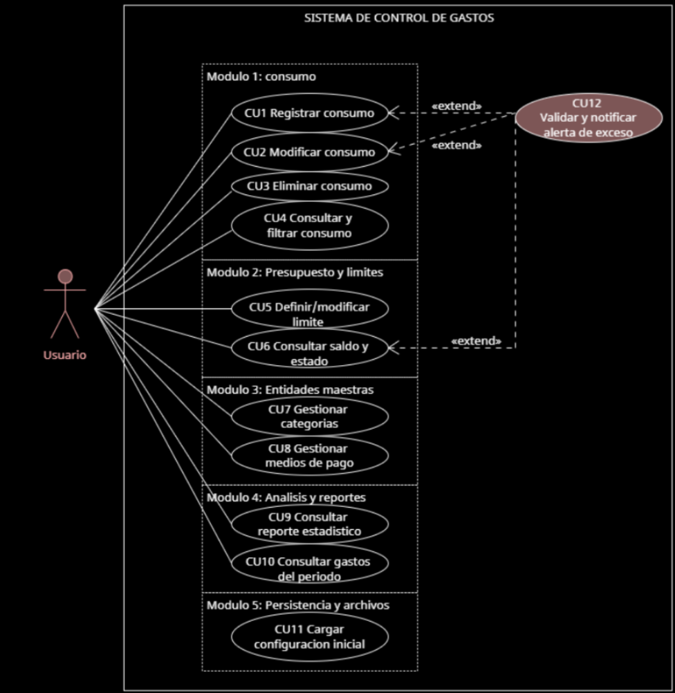

# Gestor de Gastos

## Documentación de Análisis

### P1. Objetivo y alcance

El objetivo del Sistema de Control de Gastos es permitir que el usuario registre y administre sus gastos personales, controle sus presupuestos y analice sus hábitos de consumo, facilitando la organización de sus finanzas.

El sistema abarca la gestión de consumos, incluyendo su registro, modificación, eliminación, consulta y filtrado; la definición de límites de gastos; la administración de categorías y medios de pago; y la generación de reportes estadísticos y consultas de gastos por período.

Además, contempla la persistencia de la información mediante archivos locales, la carga automática de una configuración inicial y la exportación de reportes. También permite verificar el cumplimiento de los límites establecidos y notificar al usuario cuando se detecten excesos o situaciones que requieran atención.

El sistema está destinado a un usuario que interactúa con sus funcionalidades para mantener un registro organizado y actualizado de sus gastos.

### P2. Descripción de alto nivel del sistema

El Sistema de Control de Gastos es una aplicación que centraliza la información sobre los consumos del usuario y permite realizar un seguimiento de sus gastos y presupuestos.

El sistema se organiza en cinco módulos principales:

- **Módulo 1: Consumos.** Permite registrar, modificar, eliminar, consultar y filtrar gastos según diferentes criterios.
- **Módulo 2: Presupuesto y límites.** Permite definir límites de gastos, consultar el saldo disponible y conocer el estado del presupuesto mediante indicadores visuales.
- **Módulo 3: Entidades maestras.** Permite gestionar las categorías de gastos y los medios de pago disponibles.
- **Módulo 4: Análisis y reportes.** Permite consultar estadísticas y obtener información sobre los gastos realizados durante un período.
- **Módulo 5: Persistencia y archivos.** Permite cargar la configuración inicial, guardar y recuperar información mediante archivos locales y exportar reportes.

### P3. Requerimientos funcionales

#### RF01. Gestión de consumos (CU1, CU2 y CU3)

El sistema debe permitir al usuario registrar (CU1), modificar (CU2) y eliminar (CU3) consumos, almacenando el monto, la fecha, el concepto, la categoría y el medio de pago. Cuando corresponda, también debe permitir indicar la cantidad de cuotas.

Al abrir la pantalla de registro, el sistema debe completar automáticamente la fecha actual y seleccionar la última categoría y el último medio de pago utilizados, cuando exista un registro previo.

El concepto debe admitir hashtags para facilitar la búsqueda posterior de consumos relacionados, por ejemplo, `Almuerzo #trabajo` o `Nafta #viaje`.

El sistema debe validar el monto en tiempo real, impidiendo guardar consumos con valores iguales o inferiores a cero y mostrando un mensaje de error antes de confirmar la operación.

#### RF02. Consulta y filtrado de consumos (CU4)

El sistema debe permitir consultar los consumos registrados y filtrarlos por período, categoría, medio de pago y palabra clave, incluyendo hashtags.

#### RF03. Gestión de límites (CU5)

El sistema debe permitir definir y modificar límites monetarios de gastos para períodos determinados.

Debe contemplar un límite mensual general y límites específicos por categoría, permitiendo controlar tanto el gasto total como el correspondiente a cada categoría.

El presupuesto debe reiniciarse automáticamente al comenzar un nuevo período mensual, sin eliminar el historial de consumos de los períodos anteriores.

#### RF04. Consulta de saldo y estado (CU6)

El sistema debe calcular el saldo disponible del presupuesto y determinar su estado según el porcentaje consumido del límite establecido.

El estado debe representarse mediante un indicador visual tipo semáforo:

- **Verde:** menos del [ver] % del límite consumido.
- **Amarillo:** desde el [ver] % hasta menos del 100 % del límite consumido.
- **Rojo:** [ver] % o más del límite consumido.

El sistema debe mostrar información clara sobre el porcentaje consumido y el saldo disponible.

#### RF05. Gestión de categorías (CU7)

El sistema debe permitir gestionar las categorías de gastos, incluyendo las categorías predefinidas Comida, Transporte, Servicios, Salud y Entretenimiento.

Estas categorías deben cargarse automáticamente durante la configuración inicial. El usuario debe poder administrar las categorías disponibles.

#### RF06. Gestión de medios de pago (CU8)

El sistema debe permitir gestionar los medios de pago disponibles, contemplando las siguientes modalidades:

- **Efectivo:** registra el importe del consumo sin comisiones.
- **Tarjeta de débito:** registra el importe del consumo sin recargos por cuotas.
- **Tarjeta de crédito:** permite indicar la cantidad de cuotas y los recargos correspondientes, cuando apliquen.
- **Transferencia:** permite registrar el alias o CBU asociado al medio de pago.

El diseño debe aprovechar el polimorfismo para representar los comportamientos específicos de los distintos medios de pago cuando corresponda.

#### RF07. Consulta de reportes estadísticos (CU9)

El sistema debe generar reportes estadísticos que permitan analizar la distribución de los gastos por categoría y conocer qué proporción del gasto total corresponde a cada una.

También debe permitir comparar el gasto total del mes actual con el del mes anterior, mostrando la variación porcentual entre ambos períodos.

#### RF08. Consulta de gastos del período (CU10)

El sistema debe permitir consultar los gastos consolidados correspondientes a un período determinado y conocer el importe total gastado durante ese intervalo.

#### RF09. Carga de configuración inicial (CU11)

El sistema debe cargar automáticamente la configuración inicial y los datos almacenados al iniciar la aplicación.

Si no existen los archivos locales, debe generar los archivos base y cargar las categorías y entidades maestras predefinidas, sin requerir la intervención del usuario ni sobrescribir información existente.

#### RF10. Validación y notificación de alertas de exceso (CU12)

El sistema debe verificar los límites establecidos ante operaciones que modifiquen o consulten los gastos, mediante una relación `<<extend>>` con CU1, CU2 y CU6.

Cuando el presupuesto alcance o supere el 100 % de ejecución, el sistema debe notificar al usuario mediante una advertencia visual en forma de diálogo flotante.

Cuando el consumo alcance el 70 % del límite sin llegar al 100 %, debe mostrar una advertencia preventiva que indique el porcentaje consumido.

#### RF11. Exportación de reportes

El sistema debe permitir exportar reportes de gastos en formato CSV para facilitar su consulta y procesamiento en otras aplicaciones, como Excel.

#### RF12. Guardado automático

El sistema debe guardar automáticamente la información al cerrar la ventana principal de la aplicación, con el objetivo de reducir el riesgo de pérdida de datos.

### Diagrama de casos de uso

El sistema contempla doce casos de uso principales, organizados en cinco módulos:

- **Módulo 1: Consumos:** CU1, CU2, CU3 y CU4.
- **Módulo 2: Presupuesto y límites:** CU5 y CU6.
- **Módulo 3: Entidades maestras:** CU7 y CU8.
- **Módulo 4: Análisis y reportes:** CU9 y CU10.
- **Módulo 5: Persistencia y archivos:** CU11.
- **Caso de uso extendido:** CU12, validación y notificación de alertas de exceso.

### P4. Requerimientos no funcionales

#### RNF01. Rendimiento y tiempo de procesamiento (*Performance*)

El sistema debe procesar y guardar un consumo en un tiempo máximo de 3 segundos. Asimismo, las consultas de saldos, el filtrado de consumos y la generación de reportes deben ejecutarse en tiempos adecuados para garantizar una interacción fluida.

#### RNF02. Usabilidad y consistencia visual (*Usability*)

La interfaz debe permitir registrar un gasto en efectivo en un máximo de **[DEFINIR CANTIDAD] toques** desde la pantalla de inicio.

Debe diferenciar claramente los medios de pago mediante indicadores visuales consistentes en todas las pantallas.

Además, debe proporcionar valores por defecto inteligentes, validaciones en tiempo real y mensajes de error o advertencia comprensibles.

#### RNF03. Persistencia local y exportación de reportes (*Storage*)

Toda la información del sistema, incluidos consumos, presupuestos, categorías y medios de pago, debe almacenarse en archivos locales en formato CSV.

Al iniciar la aplicación, los datos deben recuperarse automáticamente. Si los archivos no existen, el sistema debe generar la estructura inicial sin sobrescribir información existente.

Asimismo, el sistema debe permitir exportar reportes de gastos en formato CSV y guardar automáticamente los cambios al cerrar la aplicación.

### P5. Diseño del sistema

#### Clases principales

El diseño del sistema contempla las siguientes clases, interfaces y enumeraciones:

- `Controller`
- `ControlGasto`
- `ReporteInterfaz`
- `ReporteGastosPeriodo`
- `ReporteEstadistico`
- `Consumo`
- `MedioDePago`
- `RepositorioInterfaz`
- `RepositorioArchivo`
- `CriterioRangoFechas`
- `CriterioCategoria`
- `Limite` (clase abstracta)
- `LimiteMensual`
- `Categoria`
- `Semaforo` (enumeración)

*DIAGRAMA DE CLASEEEEEEEEEEEEEEEEEEEEEEEEEEEEEEEEEEEEEEEEEEEEEEEEEEEEEEEEEEEEEEEEEEEEEES*

#### Diagramas de secuencia

*DIAGRAMAS DE SECEUNIAAAAAAAAAAAAAAAAAAAAAAAAAAAAAAAAAAAAAAAAAAAAAAAAAAAAAAAAAAAAAAAAAAAAAAAAAAAAAAAAAAAAAAAAAAAAAAAAAA*

### P6. Consideraciones de implementación
- **Lenguaje de programación:** Java.
- **Persistencia:** archivos locales CSV.
- **Lectura de archivos:** mediante `BufferedReader` o herramientas equivalentes.
- **Escritura de archivos:** mediante `BufferedWriter` o herramientas equivalentes.
- **Interfaz gráfica:** debe permitir gestionar consumos, límites, categorías, medios de pago y reportes.
- **Validaciones:** deben impedir el registro de datos inválidos y proporcionar mensajes claros.
- **Polimorfismo:** debe utilizarse para representar comportamientos específicos de los medios de pago cuando corresponda.
- **Integridad de datos:** la carga inicial no debe sobrescribir información existente y los cambios deben guardarse sin eliminar el historial de consumos.

